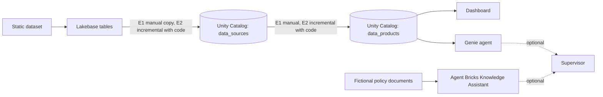

# Architecture

> Owned by the technical architect. Keep it short; link to ADRs in `/decisions` for the reasoning. Technical details are intentionally open and will be decided later.

## Target data flow


## Components
| Component | Purpose | Epic | Decision status |
|---|---|---|---|
| Lakebase | Operational source tables | E1 | Open |
| Catalog `data_sources` | Source data as loaded | E1 | Open |
| Catalog `data_products` | Curated data for consumption | E1 | Open |
| Dashboard | Analytics on `data_products` | E1 | Open |
| Genie agent | Natural-language access to `data_products` | E1 | Open |
| Agent Bricks Knowledge Assistant | Cited answers from fictional policy documents | E1 | Blocked: workspace reports `NO_AVAILABLE_PHAROS_DEPLOYMENTS` |
| Supervisor | Optional combined Genie and policy answers | E1 | Optional |
| Incremental loading | Lakebase → `data_sources` → `data_products` | E2 | Open (Change Data Feed is one option) |
| Declarative Automation Bundles | Deploy to new workspaces | E3 | Open |

## Catalog Manager and Discover Pages

The repository's Catalog Manager Ask implementation uses Genie One MCP
(`system.ai.genie_one_mcp`) with the signed-in user's accessible context, not a
single-space restriction. **The deployed app last reported
`app-service-principal` for Ask**; do not treat the repository identity as the
live identity until the deployment is aligned and retested. Catalog browses
`fincrime.data_products` (no medallion layers shown,
[decision 0004](../decisions/0004-data-products-schema.md)), including the glossary,
and access requests are stored in `fincrime.catalog_manager`. Discover Pages is a
separate account-level, domain-governed Beta feature.

**Cutover status (2026-11-17): BLOCKED by upstream Lakebase permissions.**
The following is the prepared replacement design, not the live state. The live
views still wrap gold, and Ask still uses workspace-wide Genie One.

The clarified 2026-11-17 requirement is a **replacement**, not a layer over gold.
Notebook 02 builds directly from bronze/Lakebase into `data_products`; its four
views contain the original business logic with internal references moved to
`data_products`. Notebook 03 writes policy documents there too. Notebook 06 is now
an optional one-time migration (`migrate_from_source=true`), followed by sandbox
initialization/verification; ordinary runs do not read gold.
The app-owned glossary and destination-only sandbox are preserved. Gold is kept
only pending consumer cutover and separately approved deletion (decision 0004).

```text
Catalog Manager Glossary -> fincrime.data_products.business_glossary -> Genie space
                         -> selected-term document download
                            -> Discover Pages / Genie Code bulk import
                               -> human review and publication -> Genie One
Catalog Manager Ask (repository code) -> user-forwarded OAuth token (ai-gateway scope) -> Genie One MCP
                                      -> accessible data and published Pages
Catalog Manager Ask (last deployed identity check) -> app service principal -> Genie One MCP
Catalog Manager Access card -> user-forwarded OAuth token (sql scope)
                               -> GRANT / REVOKE on fincrime.data_products
                            -> app SP -> request rows in fincrime.catalog_manager.access_requests
```

The Pages tab is a manual import handoff, not a Pages CRUD API or two-way sync.
No documented public Pages CRUD API was identified during implementation.
Publication remains manual. The 2026-10-28 live API check returned the
Concentration of transfers Page definition and citation through the deployed
app; this is historical acceptance evidence, not proof of the current identity
or second-user access. The repository Ask implementation uses the caller's token
without app-SP fallback, shared clients, or a conversation cache. Metadata writes
remain app-SP operations; a user-attributed change audit is not implemented for them.
Access grants and revokes run with the signed-in approver's token
([decision 0005](../decisions/0005-access-approvals-as-approver.md), proposed); the
app SP only stores the request rows.
See the [Pages workflow](../catalog-manager/README.md#discover-pages-workflow).

## Environments
One workspace only; no separate environments. The plan is to use a Databricks Free Edition workspace; which one is still to be decided, as are ownership and governance. Feature availability and limits on Free Edition (Lakebase, Genie, dashboards, bundles) must be verified.

## Non-functional requirements
- Security: no secrets or customer data in the repo
- Reproducibility: a new person can rebuild the demo from this repo (E2/E3)

## Related decisions
See `/decisions`.
