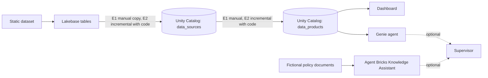

# Architecture

> Owned by the technical architect. Keep it short; link to ADRs in `/decisions` for the reasoning. Technical details are intentionally open and will be decided later.

## Target data flow


## Components
| Component | Purpose | Epic | Decision status |
|---|---|---|---|
| Lakebase | Operational source tables | E1 | Open |
| Catalog `data_sources` | Source data as loaded | E1 | Open |
| Catalog `data_products` | Curated data for consumption | E1 | Open |
| Dashboard | Analytics on `data_products` | E1 | Open |
| Genie agent | Natural-language access to `data_products` | E1 | Open |
| Agent Bricks Knowledge Assistant | Cited answers from fictional policy documents | E1 | Blocked: workspace reports `NO_AVAILABLE_PHAROS_DEPLOYMENTS` |
| Supervisor | Optional combined Genie and policy answers | E1 | Optional |
| Incremental loading | Lakebase → `data_sources` → `data_products` | E2 | Open (Change Data Feed is one option) |
| Declarative Automation Bundles | Deploy to new workspaces | E3 | Open |

## Catalog Manager and Discover Pages

The implemented Catalog Manager app uses the new `system.ai.genie_one_mcp`
through Unity Gateway for Ask and `fincrime.gold` for metadata and glossary management. Discover Pages
is a separate account-level, domain-governed Beta feature.

```text
Catalog Manager Glossary -> fincrime.gold.business_glossary -> Genie space
                         -> selected-term document download
                            -> Discover Pages / Genie Code bulk import
                               -> human review and publication -> Genie One
Catalog Manager Ask -> user-forwarded OAuth token -> Unity Gateway Genie One MCP
                    -> Genie Ontology (accessible published Pages/domains) and data
```

The Pages tab is a manual import handoff, not a Pages CRUD API or two-way sync.
No documented public Pages CRUD API was identified during implementation.
Publication remains manual. Page citations can now be checked in Ask; the
2026-10-28 live API check returned the Concentration of transfers Page definition
and citation through the deployed app. Each MCP request uses the caller's token
without app-SP fallback, shared clients, or a conversation cache. Metadata writes
remain app-SP operations; a user-attributed change audit is not implemented.
See the [Pages workflow](../catalog-manager/README.md#discover-pages-workflow).

## Environments
One workspace only; no separate environments. The plan is to use a Databricks Free Edition workspace; which one is still to be decided, as are ownership and governance. Feature availability and limits on Free Edition (Lakebase, Genie, dashboards, bundles) must be verified.

## Non-functional requirements
- Security: no secrets or customer data in the repo
- Reproducibility: a new person can rebuild the demo from this repo (E2/E3)

## Related decisions
See `/decisions`.
