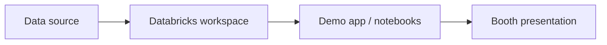

# Architecture

> Owned by the technical architect. Keep it short; link to ADRs in `/decisions` for the reasoning.

## Overview
_TBD — one paragraph and a diagram (Mermaid is rendered natively by GitHub)._

## Components
| Component | Purpose | Tech | Owner |
|---|---|---|---|
| _TBD_ | | | |

## Environments
| Env | Where | Purpose |
|---|---|---|
| dev | _TBD_ | development |
| demo | _TBD_ | booth / video recording |

## Non-functional requirements
- Reliability: demo must work with poor booth network (offline fallback)
- Security: no secrets or customer data in the repo
- Reproducibility: demo can be rebuilt from this repo by a new person

## Related decisions
See `/decisions`.
