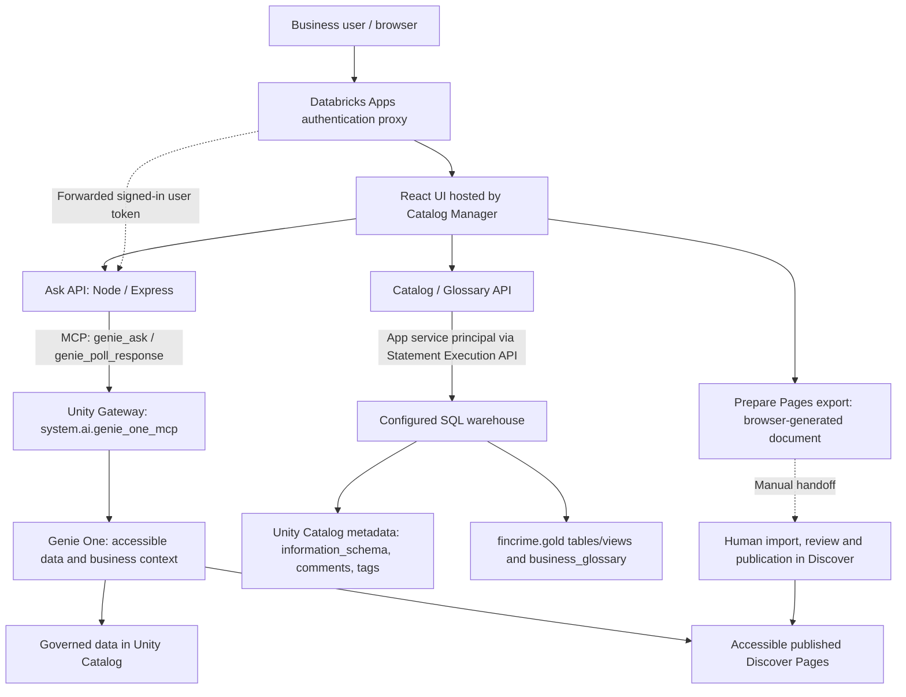

# Catalog Manager: team pre-demo and Summit video guide

Prepared: 2026-11-05. Audience: business stakeholders, architects and demo team.
Team walkthrough: 20 minutes plus questions. Summit video proposal: 3 minutes.

App: https://catalog-manager-7474649527621307.aws.databricksapps.com

This is the current presenter guide. It supersedes the older screenshot's
single-space Ask narrative. Source inspection was performed for this guide;
the prompts below are a rehearsal script, not a new live acceptance run.

## 1. The story to tell

> "An investigator needs to understand a payment pattern, not just find a number.
> This app brings together natural-language questions, inspectable SQL, catalog
> metadata, and reviewed business definitions. Databricks remains the platform
> for data, access control, and AI services; the app is the business-facing interface."

The loop is **ask -> inspect evidence -> clarify metadata -> draft business meaning
-> review and publish -> ask with a cited definition**.

Do not imply every step happens automatically. A glossary save is not publication,
and editing a comment does not guarantee an immediate change in an AI answer.

### Corrections to the supplied guide image

| Image statement / expectation | Accurate statement for this app |
|---|---|
| "Ask is limited to our Genie space" | Ask uses Genie One MCP and the user's accessible context, not a hard single-space boundary. Use `fincrime.gold` in prompts to focus the investigation; that is context, not authorization. |
| "7 customers" | Seven is the seeded dataset's expected result. Rehearse against current data; do not promise a fixed result without checking it. |
| "Show a bar chart" | The custom UI renders answer text, Markdown tables, SQL, and any embedded statement-response JSON, not native chart widgets. Use **Open in Genie One** for a workspace visualization if available and rehearsed. |
| "Who changed what is recorded" | No app-level per-user change-history screen exists. Catalog/Glossary use app identity; the glossary's owner field is entered text, not authenticated authorship. |
| "Glossary and Pages" | The tab is **Prepare Pages export**. Import, review and publication happen separately in Databricks. |
| Workspace Genie One is needed to show Page citations | Ask also uses Genie One MCP now. Show its citation in the app, then optionally open the Page in Databricks. |

## 2. What is built, in plain language

| Component | Role | What it is not |
|---|---|---|
| React + TypeScript frontend | Home, Ask, Catalog, Glossary and export screens | Not a separate database or AI model |
| AppKit UI + Tailwind styling | Cards, buttons, identity badge, responsive navigation and theme | Not the source of business logic |
| Vite | Bundles frontend assets for the browser | Not the production data engine |
| Node.js + Express through Databricks AppKit | Serves the UI and backend routes | Does not itself train a model |
| Databricks Apps | Hosts the application and provides the authenticated proxy | Opening the app does not grant access to all data |
| Unity Catalog | Governs tables/views, metadata, tags and permissions | Not the compute engine executing SQL |
| SQL warehouse | Executes Catalog/Glossary statements; provides query compute | Not the durable data store |
| Genie One | Finds relevant accessible context and answers natural-language questions, using SQL where appropriate | Not guaranteed to produce identical answers every time |
| MCP | Model Context Protocol: a standard interface for invoking Genie tools | Not a model, data copy, or replacement for authorization |
| Discover Pages | Reviewed business concepts/definitions that can ground Genie One answers | Not the app's glossary table |

### Architecture to show the team

Solid arrows are implemented request paths. Dashed publication is manual.
The custom Catalog/Glossary API uses the configured warehouse directly; do not
claim the Genie One service is forced to use that same warehouse or one space.

### The two identities: the most important technical distinction

| Operation | Executing identity | Consequence |
|---|---|---|
| Ask / poll Genie One | Signed-in user's forwarded OAuth token | Their service, domain and data permissions apply. No app-service-principal fallback. |
| List Catalog objects, preview rows, change comments/tags | App service principal through `WorkspaceClient` | The view and allowed changes reflect app identity, not per-user data filtering. |
| Read/write/delete Glossary terms | App service principal | No authenticated per-user author attribution is captured by this app. |
| Prepare export | Browser, using glossary rows read by the backend | No Discover Page is created. |
| Publish a Page | Human performing the workspace action | Requires their publication/domain rights. |

Say:
> "Ask preserves the caller's identity. Metadata editing currently uses app
> identity. That is a prototype boundary we need to address before broad production use."

App logs are operational diagnostics, not a complete business audit trail.
Platform audit records require separate access and verification; do not present
them as proven per-human edit history. A classification label alone does not
enable masking or deny access; an applicable policy must be configured separately.

## 3. Where the demo data comes from

The repository's data-generation and gold-build notebooks prepare fictional data
before the app runs. The app does not run those notebooks when a user opens it.

- [Bronze generator](../src/01_generate_bronze_data.py): synthetic source data.
- [Gold products](../src/02_build_gold_data_products.py): curated tables/views,
  comments and checks for the planted investigation story.
- Gold tables include `customer_360`, `transactions`, `counterparties` and `case_notes`.
- Views include `alerts`, `structuring_candidates`, `counterparty_network` and `data_as_of`.
- [Policy preparation](../src/03_policy_docs.py): fictional policy sections in
  `fincrime.gold.policy_docs`, not a live PDF retrieval service.
- [Glossary-space setup](../src/05_genie_glossary_space.py): separately adds the
  glossary table and lookup instructions to a curated Genie space. This is not
  the current Ask request path or an automatic Genie One publication mechanism.

Lakebase is part of the wider demo architecture for investigator decisions.
The gold notebook uses `fincrime_source.public.case_decisions` if that catalog
exists; otherwise it uses a local Delta fallback. **Verify the live view's
dependency before claiming live Lakebase integration.** This app has no
investigator-decision write-back screen.

### Explain the planted structuring story accurately

The gold view selects customers with at least five incoming cash deposits of
9,000 to below 10,000 SEK in its last-14-day window. These are fictional demo
thresholds, not an assertion about a statutory reporting threshold.

The window is anchored to the latest transaction in the dataset, not necessarily
today. The seeded checks expect:

- Seven candidates: `C0580` and `C0591` through `C0596`.
- Six planted accounts concentrate transfers to recipient `X9001`.
- `C0580` is a comparison case with more dispersed payments.
- `top_onward_counterparty_share` is a 0-to-1 share of outgoing **transfer
  amounts** paid to the largest transfer recipient. `0.94` means 94%, not a
  risk score, 94 transactions, or 94% of all outgoing payment channels.
- `outflow_to_inflow_ratio` compares all outgoing and incoming amounts in the
  window; it is a different measure from transfer concentration.

These are source-defined seed expectations, not freshly verified current counts.
Use neutral language: "candidate", "pattern consistent with", "needs review".
An investigator decides; the app does not determine criminality.

## 4. Detailed team walkthrough: show, say, explain, verify

### 0:00-2:00 | Open Home and frame the prototype

**Show:** Home with the four workflow cards. Then point to Ask and Catalog.

**Say:**
> "This is a working prototype for our Summit story. A business user can ask
> questions, inspect the evidence, improve descriptions, and prepare shared
> definitions without editing application code. The underlying data stays in Databricks."

**Explain:** React runs in the browser; Databricks Apps hosts the Node backend
and compiled assets. Backend calls use either user identity or app identity,
depending on the feature.

**Verify:** The app opens under the chosen recording account. Do not equate
a successful homepage load with successful Genie authorization.

### 2:00-7:00 | Ask: from a business question to inspectable evidence

**Show:** The **Querying as** badge, type a question, submit, wait for status,
then expand **Generated SQL and results** when present.

**Prompt 1:**
> "Using fincrime.gold.structuring_candidates, which customers are structuring
> candidates? List customer_id, near_threshold_deposits, account_age_days,
> outflow_to_inflow_ratio, top_onward_counterparty and
> top_onward_counterparty_share. Explain the candidate rule and data-as-of date."

**Follow-up:**
> "Compare these candidates by account age, outflow-to-inflow ratio and share
> of outgoing transfers paid to the largest recipient. Which ones share the
> same largest recipient? Explain why concentration alone is not a conclusion."

**Say:**
> "The frontend is not inventing an answer or running a hardcoded report.
> It calls our backend, which invokes Genie One through MCP using my identity.
> I can inspect the SQL when the answer includes a query."

**Behind the scenes:**
1. The UI posts `action: ask` and the question to `/api/ask`.
2. The backend requires forwarded user and access-token headers and validates
   the request with Zod.
3. It creates a fresh MCP client and calls `genie_ask` on
   `/ai-gateway/mcp-services/system.ai.genie_one_mcp?o=<workspace-id>`.
4. The service returns conversation/response IDs. The UI polls approximately
   every three seconds through `genie_poll_response`.
5. The UI renders final Markdown, including GFM tables (numeric columns
   right-aligned; wide tables scroll), HTTPS citations, returned SQL, and a deep link.
   The backend does not execute the returned SQL a second time.
6. Follow-ups pass the conversation ID. **New conversation** resets local chat
   state; it does not delete the conversation stored by the Genie service.

**Verify:** Relevant source and time window; no invented metrics; no duplicated
customer rows; inspect query details rather than trusting a familiar-looking answer.

**Limits:** The app implements ask/poll only. It does not retrieve query results
through `genie_get_query_result` or render native charts. **Stop** stops waiting
in the UI, not the server-side Genie operation. For a rehearsed chart, follow
**Open in Genie One** and demonstrate the workspace result, clearly naming it.

### 7:00-11:00 | Catalog: improve metadata at its source

**Show:** Catalog, a table's columns, classification and 20-row preview.
For writes, use the existing `smoke_test` sandbox, not customer business tables.

**Before editing:** Capture its existing description and classification privately
so they can be restored. Ensure no other teammate is editing that object.

**Do:** Change only the sandbox description to
"Demo sandbox for reviewed metadata edits; no customer records." Click **Save**.
Set the sandbox classification to **Internal**, noting the immediate save.
Open the same object in Catalog Explorer and refresh to show the persisted metadata.

**Say:**
> "These are real catalog comments and tags, not labels stored only in this UI.
> Descriptions help people understand the data and can supply context to tools.
> Classification records an intent; enforcement needs a separate policy."

**Behind the scenes:**
- Table/column lists query Unity Catalog `information_schema` and tag metadata.
- Preview is a read of up to 20 rows, not a complete dataset download.
- Description writes use `COMMENT ON TABLE` or `COMMENT ON COLUMN`.
- Classification uses `SET TAGS` / `UNSET TAGS`; the dropdown saves immediately.
- All these operations go through the Statement Execution API and warehouse
  under the app service principal.

**Do not show:** A nonexistent human edit-history screen. Explain the missing
audit/authorization feature openly. Do not claim a before/after answer improvement
unless the exact change has been rehearsed and the changed answer is observed.

**Cleanup:** Restore the exact previous sandbox description/tag after the walkthrough.

### 11:00-14:00 | Glossary: draft the team's business language

**Show:** Glossary and its fields. Use an existing suitable term, or create a
clearly temporary rehearsal term that does not overwrite a real term.

**Suggested draft:**
- Term: `Demo - concentration of transfers`
- Definition: "Share of a customer's outgoing transfer amount over the last
  14 days paid to the largest recipient, from 0 to 1. A value of 0.94 means 94%."
- Related table: `fincrime.gold.structuring_candidates`
- Related column: `top_onward_counterparty_share`
- Owner: leave blank, or use a non-personal team role such as `Demo team`.

**Say:**
> "This is our editable working glossary. We capture meaning and a suggested
> data link. Saving here stores a row in a lakehouse table; it is not publishing
> a Discover Page or automatically changing Genie One."

**Behind the scenes:** `/api/glossary` reads/writes
`fincrime.gold.business_glossary`. Save replaces a case-insensitive term match
using delete then insert. The row contains definition, related asset, owner and
updated timestamp; it is not an immutable versioned business audit record.
Related table/column values are text references, not verified UC lineage links.

**Verify:** Term appears after save/refresh. If the chosen term already exists,
do not overwrite it for the demo. Delete only the temporary term you created.

### 14:00-17:00 | Prepare Pages export: make the publication boundary visible

**Show:** **Prepare Pages export**, select the term, enter the actual existing
Discover domain, inspect the preview, and check the content-review confirmation.
Click **Download for Pages import**.

**Say:**
> "We prepare a proposed definition here. Downloading does not create or publish
> a Page. A domain owner still reviews the definition and its linked assets in
> Databricks before publication."

**Behind the scenes:** The page reads the same glossary API. Browser code builds
`proposed-business-pages.md` and an import prompt. Owner fields and data rows are
excluded, but definitions and asset names must still be reviewed for sensitive
content. The confirmation is a UI gate, not a content scanner or approval record.

**Optional workspace action:** In Discover, use the available Pages/Genie Code
import workflow, review duplicates and draft content, verify assets and owners,
then publish only with the authorized human's approval. Workspace navigation may
vary; rehearse the actual UI. No automatic Pages CRUD/list/sync integration exists.

**Fallback:** Show the export and a pre-published Page. Say explicitly that
publication was completed beforehand. Do not create a duplicate Page just for filming.

### 17:00-20:00 | Close the loop with a cited Page

**Show:** Start a new Ask conversation and submit:

> "What does Concentration of transfers mean in the Financial Crime domain?
> Explain what 0.94 represents and cite the published Page."

Use the actual accessible domain name if it differs.

**Expected evidence, not guaranteed wording:** A definition specifying the
14-day window, largest recipient and 0.94 = 94%; a link to the published Page.
The deployed API returned this Page citation during earlier session verification:
`901ecc5d-b8ea-4997-a022-305bdec418f5`.

**Say:**
> "Now we can inspect not just the answer, but the business definition behind it.
> The Page supplies reviewed meaning; the data query supplies numerical evidence.
> MCP is the bridge from our app to Genie One, not the source of the definition."

**Then:** Open the citation to inspect the Page, or use **Open in Genie One**.
Explain that both entry points use Genie One, but separate conversation histories
can produce different responses. A definition-only answer may have no SQL:
that is expected, not a missing query.

**Close:**
> "The prototype connects insight, metadata and reviewed meaning. Before the
> Summit recording we must finish second-user access checks, rehearse the exact
> prompts, and be explicit about manual publication and app-identity writes."

## 5. Technical appendix: source tour for the team

| Explain | Open this file | What to point out |
|---|---|---|
| Navigation and Home | [App.tsx](../catalog-manager/client/src/App.tsx) | React routes and the four workflow cards |
| Ask experience | [AskPage.tsx](../catalog-manager/client/src/pages/ask/AskPage.tsx) | Identity fetch, submit/poll, SQL details, disclaimer and deep link |
| Answer rendering | [AnswerMarkdown.tsx](../catalog-manager/client/src/pages/ask/AnswerMarkdown.tsx) | `remark-gfm` tables, numeric right-alignment, HTTPS-only links, scrollable table region |
| Entry point | [server.ts](../catalog-manager/server/server.ts) | AppKit `analytics()` and `server()` plugins; custom route registration |
| MCP bridge | [genie-one.ts](../catalog-manager/server/genie-one.ts) | Forwarded caller token, fresh MCP client per request, fixed service URL, ask/poll allowlist, no SP fallback |
| Response validation | [shared/genie-one.ts](../catalog-manager/shared/genie-one.ts) | Zod request and response contracts |
| Metadata and glossary | [catalog.ts](../catalog-manager/server/catalog.ts) | App SDK credentials; Statement Execution API; UC comments/tags versus glossary rows |
| Export generation | [pages-export.ts](../catalog-manager/client/src/pages/pages/pages-export.ts) | Selected-term Markdown and proposed import prompt, no Pages API call |
| Publication guidance | [PagesPage.tsx](../catalog-manager/client/src/pages/pages/PagesPage.tsx) | Review checkbox, download and manual handoff |
| Runtime configuration | [app.yaml](../catalog-manager/app.yaml) | Start command, host, workspace ID and warehouse resource mapping |
| Declared resources | [databricks.yml](../catalog-manager/databricks.yml) | `sql` / `ai-gateway` user scopes and declared resources |

AppKit's Analytics plugin is registered, but the custom Catalog/Glossary screens
currently use Express routes and the SQL Statement API, not the template sample
analytics queries. Ask uses a custom MCP client, not AppKit's `genie()` plugin.
The Genie-space resource remains declared; its presence does not restrict Genie One.
There is no custom model endpoint, training workflow or vector index implemented
in this app's Ask request path.

Build overview: npm-managed TypeScript project; React/Vite builds browser assets,
TypeScript/tsdown prepares server output, and Databricks Apps builds/starts the
uploaded workspace source. Explain the deployed source snapshot, not an assumed
automatic GitHub-to-production pipeline.

## 6. Summit video storyboard: proposed 3-minute cut

Record successful, rehearsed segments separately. Do not attempt an unpredictable
end-to-end live import during the final take. This guide does not create a video.

| Time | Picture / action | Voiceover |
|---|---|---|
| 0:00-0:20 | Home and title: "From data to shared business meaning" | "Investigators need trustworthy context, not just a list of transactions. This Databricks App brings questions, metadata and reviewed definitions together." |
| 0:20-1:00 | Ask candidate question; show completed evidence and expand SQL | "We ask in plain language. Genie One is called through MCP as the signed-in user. We inspect the SQL and the pattern rather than treating an AI answer as a decision." |
| 1:00-1:25 | Catalog sandbox description edit; briefly show the same UC comment | "Business users can improve descriptions and classification at the catalog source. This prototype performs metadata operations through the app identity." |
| 1:25-1:50 | Glossary term, then export preview/review gate | "A business definition starts as a glossary draft. We review proposed content before exporting it for publication." |
| 1:50-2:10 | Pre-published Page in Discover, labelled "Published beforehand" | "A domain owner reviews and publishes the Page in Databricks. Export is a manual handoff, not automatic publication." |
| 2:10-2:45 | Ask concentration question; show 0.94 explanation and click Page citation | "Genie One can now use the accessible published definition. A concentration of 0.94 means 94 percent of transfer value goes to one recipient. The citation lets us inspect the source." |
| 2:45-3:00 | Architecture graphic / closing title | "A business-facing interface over governed data and shared meaning, with humans responsible for publication and investigation decisions." |

Keep the statement "can now use" tied to the already-published Page, not to an
implied instantaneous export-to-answer update. Use a static architecture graphic
from section 2; no animated claims about unimplemented integrations.

### Recording rules

- Use only fictional/demo records and approved Page content. Hide personal
  identity badges, browser profile details, account IDs and notifications in
  the public recording as appropriate; never reveal tokens or auth headers.
- Record at 1920x1080 if available, keep browser zoom readable, and hide bookmarks.
- Use a tested presenter account. Complete consent and warm up query compute
  before recording; do not film login flows.
- Cut or accelerate waiting time only with a visible "Waiting time shortened"
  note. Keep the question, returned evidence and source citation truthful.
- Verify SQL, units, percentage interpretation and definitions before choosing
  a take. Do not force a seven-customer claim if current data differs.
- If visualizations are shown in workspace Genie One, label that surface.
- Keep subtitles/captions and narration consistent with the final recorded screens.
- A recording of the known successful path is the booth fallback, not proof
  that every workspace user has passed acceptance.

## 7. Preflight, recovery and reset

### Before the team session / recording

- [ ] Check app RUNNING and compute ACTIVE; authenticated health responds.
- [ ] Rehearse both investigation and published-Page questions in the actual app.
- [ ] Test the designated second user. Existing workspace app access and inherited
  account-users MCP EXECUTE have been observed, but second-user 403 remains unresolved.
- [ ] On 403, verify current OAuth consent for `ai-gateway`, then effective
  service/parent/domain/data access with an administrator. Do not switch to a
  shared identity to disguise failure.
- [ ] Confirm the Page citation opens for the presenter and intended audience.
- [ ] Inspect current seed results/date; do not rerun data generators blindly.
- [ ] Confirm the sandbox exists, record its original metadata and coordinate
  with teammates. A tag change persists immediately.
- [ ] Check the actual Discover import UI and domain publishing permissions if
  demonstrating publication; otherwise use the declared pre-published fallback.
- [ ] Agree which limitations are visible in the team session versus summarized
  in the video. Do not omit material identity/publication boundaries.

### If something fails during the walkthrough

| Symptom | Presenter action |
|---|---|
| Ask 403 | Explain per-user authorization failure; use a previously captured, labelled example. Do not claim all-user acceptance. |
| Long-running answer | Explain asynchronous polling; move to Catalog and return later, or use a labelled recording. |
| Wrong source / result | Inspect SQL/source; add the specific data product and time context. Acknowledge the failed response rather than editing the meaning live. |
| No chart | Use the text/SQL evidence. Show workspace visualization only if previously verified. |
| Pages import unavailable | Show reviewed export and pre-published Page, explicitly separating the two steps. |
| App 502 / unavailable | Inspect deployment and startup status. A running compute instance is not proof the application started. Coordinate any redeploy with teammates. |

### After the session

- [ ] Restore sandbox metadata to its captured original state.
- [ ] Delete only the temporary glossary term created for rehearsal.
- [ ] Do not delete shared Pages or published definitions without owner approval.
- [ ] Capture actual outputs, discrepancies and which user was tested in the
  acceptance record; keep sensitive diagnostics out of the public video.
- [ ] Have a human approve Summit claims and video before publication.

## 8. Questions the team is likely to ask

**Is this a new chatbot model?** No. It is an app using Genie One through MCP.
The UI, validation and orchestration are ours; response generation is Databricks.

**Does MCP bypass Unity Catalog?** No. It is the tool interface. The Ask caller's
service/data access remains relevant. The separate metadata path uses app identity.

**Why keep Glossary if Pages exist?** It is a convenient editable draft table
and export source. Pages are separately reviewed/published business context.
There is currently duplication, not two-way synchronization.

**Can I see workspace Pages in Prepare Pages export?** No. It lists glossary
terms for export, not existing Pages. Ask can nevertheless cite accessible Pages.

**Does saving a glossary row immediately improve Ask?** Not guaranteed. There is
no automatic publish/index/update loop in the app. Demonstrate the published
Page and its actual citation instead.

**Does selecting PII mask the data?** Not by itself. A tag is metadata; a matching
enforcement policy must be configured separately.

**Can we show who edited a definition?** Not as a verified human audit trail
today. Glossary owner and updated time are not authenticated edit history.

**Does the app decide whether a customer is committing a crime?** No. The
fictional rules identify patterns for review. The investigator makes decisions.

**What needs finishing before a broader rollout?** Second-user access validation,
per-user metadata authorization and audit, reliable acceptance evidence, and
any desired native result/chart rendering. Pages synchronization remains a
separate capability, not a label change.
